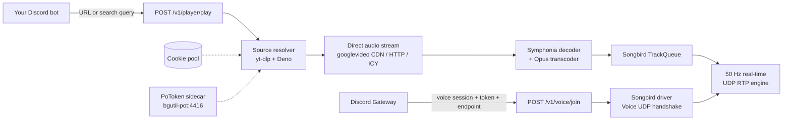

<div align="center">
<p align="center">
  <picture>
    <source media="(prefers-color-scheme: dark)" srcset="assets/light_1.svg">
    <source media="(prefers-color-scheme: light)" srcset="assets/dark_1.svg">
    
  </picture>
</p>

**Ultra-lightweight, bare-metal Discord audio engine written in Rust.**

A zero-GC, sub-millisecond, low-memory replacement for Java Lavalink.

[](LICENSE)
[](https://www.rust-lang.org/)
[](https://github.com/Shnimlz/axAudio/pkgs/container/axaudio)
[](https://github.com/Shnimlz/axAudio/releases)
[](https://github.com/serenity-rs/songbird)
[](https://github.com/Shnimlz/axAudio/stargazers)
[](https://github.com/Shnimlz/axAudio/issues)

[**Docs Index**](docs/README.md) ·
[**DSP Engine**](docs/dsp.md) ·
[**Architecture**](docs/architecture.md) ·
[**API Reference**](docs/api.md) ·
[**Quick Start**](#-quick-start)

|  📦 Binary  |    🧠 RAM    | 🚀 Startup |    🎚️ Transport     |
| :---------: | :----------: | :--------: | :-----------------: |
| **~8.4 MB** | **~8–15 MB** | **< 5 ms** | **50 Hz RTP / UDP** |
</div>

<br>

## 📖 Table of Contents

- [Why axAudio?](#-why-axaudio)
- [Features](#-features)
- [Architecture & Documentation](#-architecture--documentation)
- [Quick Start](#-quick-start)
- [Running on Bare Metal](#-running-on-bare-metal)
- [Configuration](#%EF%B8%8F-configuration)
- [REST API Reference](#-rest-api-reference)
- [YouTube Anti-Bot & BotGuard](#%EF%B8%8F-youtube-anti-bot--botguard)
- [Discord Bot Integration](#-discord-bot-integration)
- [Roadmap](#-roadmap)
- [Contributing](#-contributing)
- [Disclaimer](#%EF%B8%8F-disclaimer)
- [License](#-license)

## 📚 Technical Documentation

Comprehensive engineering documentation is available under [`/docs`](docs/README.md):

- 📐 [**Architecture & Concurrency**](docs/architecture.md): Zero-GC guarantees, thread pool tuning, Songbird driver integration.
- 🎛️ [**DSP Processing Engine**](docs/dsp.md): Mathematical specification of 15-band TDF-II biquads, phase-coherent Mid/Side 3D widening, acoustic crossfeed, and soft-clip limiting.
- 🌐 [**REST API Reference**](docs/api.md): Complete endpoint contracts, JSON schemas, and parameters.
- 📡 [**WebSocket Telemetry**](docs/telemetry.md): Event bus specifications (`track_start`, `track_end`, `track_error`).
- 🛡️ [**Streaming & Anti-Bot Bypass**](docs/streaming-and-sources.md): Multi-cookie pools, Deno JS runtime, and PoToken sidecar integration.
- 🚀 [**Deployment & Operations**](docs/deployment.md): Docker Compose, host networking, Tailscale mesh peering, and system sizing.

## 🤔 Why axAudio?

Running Lavalink means running a JVM. On a small VPS that is most of your RAM gone before a single song plays. **axAudio** does the same job as a single Rust binary that starts instantly and sips memory, so a 1 vCPU free-tier box can serve voice comfortably.

|                                                  |    **axAudio**     |   **Lavalink**   |
| :----------------------------------------------- | :----------------: | :--------------: |
| Language                                         |        Rust        |       Java       |
| Memory footprint                                 |    **~8–15 MB**    |     1.5 GB+      |
| Startup                                          |     **< 5 ms**     |   JVM warm-up    |
| Artifact                                         | **~8.4 MB binary** |    JVM + JAR     |
| Garbage collector                                |      **None**      |       Yes        |
| Built-in YouTube anti-bot (PoToken, cookie pool) |         ✅         | Plugin-dependent |

## ✨ Features

- 🦀 **Pure Rust core**: Songbird 0.4 + Symphonia 0.5, no GC pauses.
- 🎵 **Wide format & source support**: MP3, FLAC, AAC, OGG Vorbis, WAV, direct HTTP / ICY streams, and **native Spotify resolution** (Tracks, Playlists, Albums via 0-key public embeds).
- 📻 **Live Radio Streaming & ICY Demuxer**: Dedicated `/v1/player/live` endpoint for Icecast/SHOUTcast continuous radio streams with real-time `metadata_update` WebSocket events and zero decoder desync.
- 💾 **Persistent Guild & DSP Configuration**: Volume, loop mode, 24/7, autoplay, and complete DSP pipelines persist to disk (`settings/guild_settings.json`) across server restarts.
- 🎛️ **Granular DSP & Extended Filters**: Modular endpoints for Reverb FDN, Spatial 3D, Timescale, Loudness, Modulation, and 15-band EQ supporting Peaking, LowShelf, HighShelf, LowPass, and HighPass curves.
- 🎯 **Automatic Suggested Presets**: Track metadata automatically suggests ideal DSP presets (Bass Boost, Nightcore, Lo-Fi, Spatial 8D, Vocal Clarity, Cinema 3D) for zero-config clients.
- 📡 **Real-time transport**: direct 50 Hz UDP RTP Opus streaming with hardware-accelerated ChaCha20-Poly1305 and AES-GCM encryption.
- ⚙️ **Simple REST control plane**: Axum 0.8 on a multi-threaded Tokio runtime.
- 🛡️ **YouTube bypass & auto-healing**: QuickJS/Deno runtimes, PoToken sidecar, multi-cookie pool, and **automatic 403 Forbidden cache purge & retry**.
- ⏭️ **SponsorBlock built-in**: Real-time server-side skipping of non-musical intro/outro segments (`music_offtopic`).
- 🤖 **Multi-Bot Session Isolation**: Keyed by `(guild_id, bot_id)` so multiple bots can share the exact same axAudio instance without stealing or overwriting voice sessions, even in the same Discord server.
- 🔁 **24/7 & Continuous Loop Auto-Healing**: YouTube CDN links expire strictly after 6 hours; axAudio proactively detects expiring stream URLs and continuously auto-heals tracks across indefinite 24/7 or loop sessions.
- 🧹 **Idle Player Garbage Collector**: Configurable automatic driver teardown and socket reclamation on inactive guilds (with 24/7 and loop immunity).
- 🎧 **Studio-grade fidelity**: native 48 kHz Opus (format 251), `tanh` soft-clipping and headroom normalization.
- 🪶 **Tuned for tiny servers**: defaults to `TOKIO_WORKER_THREADS=2`, ideal for Oracle Cloud Free Tier, AWS t4g/t3a and Hetzner VPS.
- 🐳 **One-command deploy** with Docker Compose.

## 🧩 Architecture



## 🚀 Quick Start

You can run `axAudio` either using **instant pre-built Docker images** from GitHub Container Registry (zero compile time) or by **building from source** using the included multi-stage `Dockerfile`.

### 🍪 1. Export your YouTube cookies

Before launching, prepare your cookies for the YouTube anti-bot bypass:

1. Log into YouTube in a desktop browser (preferably a secondary / throwaway Google account).
2. Export your cookies in Netscape format with an extension like **Get cookies.txt LOCALLY** (Chrome / Firefox).
3. Save the file as `cookies.txt` (or a directory `./cookies/*.txt` for multi-account pool).
4. On Linux / VPS, grant write permissions so `yt-dlp` can persist refreshed session tokens:

   ```bash
   chmod 666 cookies.txt
   ```

---

### ⚡ Option A: Instant Pre-built Image (Recommended)

Pre-built multi-arch (`linux/amd64`, `linux/arm64`) images are published to **GitHub Container Registry** on every release. You don't need Rust or C++ toolchains installed.

#### With Docker Compose

Create a `docker-compose.yml`:

```yaml
services:
  axaudio:
    image: ghcr.io/shnimlz/axaudio:latest
    container_name: axaudio
    restart: unless-stopped
    ports:
      - "2333:2333"
    environment:
      - PORT=2333
      - BGUTIL_POT_URL=http://bgutil-pot:4416
      - TOKIO_WORKER_THREADS=2
    volumes:
      - ./cookies.txt:/app/cookies.txt:rw
    depends_on:
      - bgutil-pot

  bgutil-pot:
    image: brainicism/bgutil-ytdlp-pot-provider:latest
    container_name: bgutil-pot
    restart: unless-stopped
    ports:
      - "4416:4416"
```

Start the stack:

```bash
docker compose up -d
```

#### With Docker CLI

```bash
# 1. Start the PoToken provider sidecar
docker run -d \
  --name bgutil-pot \
  --restart unless-stopped \
  -p 4416:4416 \
  brainicism/bgutil-ytdlp-pot-provider:latest

# 2. Run pre-built axAudio
docker run -d \
  --name axaudio \
  --restart unless-stopped \
  -p 2333:2333 \
  -e PORT=2333 \
  -e BGUTIL_POT_URL=http://host.docker.internal:4416 \
  -v $(pwd)/cookies.txt:/app/cookies.txt:rw \
  ghcr.io/shnimlz/axaudio:latest
```

> [!TIP]
> You can pin a specific release version using `ghcr.io/shnimlz/axaudio:1.1.X` (e.g. `1.1.28`) or use `latest` for the most recent build.

---

### 🛠️ Option B: Build from Source (Coolify, Git, Custom Builds)

The repository includes a self-contained multi-stage `Dockerfile`. Use this if you are deploying directly from a Git repository in **Coolify** or if you wish to modify the Rust codebase.

```bash
git clone https://github.com/Shnimlz/axAudio.git
cd axAudio
docker compose up -d --build
```

#### Deploying in Coolify:
1. **New Resource** &rarr; **Public Repository** &rarr; `https://github.com/Shnimlz/axAudio` (branch `master`).
2. **Build Pack**: Select **`Dockerfile`**.
3. **Ports Exposes**: `2333`.
4. **Persistent Storage**: Mount your host cookies volume to `/app/cookies.txt` or `/app/cookies`.
5. **Environment Variables**: Set `BGUTIL_POT_URL` to your sidecar internal URL.

---

### ✅ Verify Deployment

Check that the server is up and inspect runtime stats:

```bash
curl http://localhost:2333/health
curl http://localhost:2333/v1/stats
```

## 💻 Running on Bare Metal

<details>
<summary><b>Prerequisites</b></summary>

<br>

| Requirement                              | Install                                                                                                                                     |
| :--------------------------------------- | :------------------------------------------------------------------------------------------------------------------------------------------ |
| **Rust & Cargo** 1.80+                   | `curl --proto '=https' --tlsv1.2 -sSf https://sh.rustup.rs \| sh`                                                                           |
| **Build tools & Opus** (Ubuntu / Debian) | `sudo apt install -y cmake pkg-config libopus-dev python3 python3-pip`                                                                      |
| **Build tools & Opus** (macOS)           | `brew install cmake opus python`                                                                                                            |
| **Build tools & Opus** (Windows)         | Install [CMake](https://cmake.org/download/) and [Python 3](https://www.python.org/), and make sure Opus is in your `PATH` (or use `vcpkg`) |
| **Deno 2+** (Linux / macOS)              | `curl -fsSL https://deno.land/install.sh \| sh`                                                                                             |
| **Deno 2+** (Windows)                    | `irm https://deno.land/install.ps1 \| iex`                                                                                                  |
| **Python packages**                      | `pip install -U yt-dlp bgutil-ytdlp-pot-provider`                                                                                           |

</details>

**1. Run the PoToken sidecar**

```bash
docker run -d --name bgutil-pot -p 4416:4416 brainicism/bgutil-ytdlp-pot-provider:latest
```

**2. Add your `cookies.txt`** (Netscape format) to the project root.

**3. Run axAudio**

```bash
# Debug mode (fast compilation)
cargo run

# Or build the stripped, LTO-optimized release binary
cargo build --release
./target/release/axAudio
```

## ⚙️ Configuration

Every tunable of `axAudio` is read from the process environment at startup. All variables are **optional**; the values in the `Default` column are baked in. Values come from your shell, a `.env` file, or Docker `environment:` blocks.

### 🔐 Server & Auth

| Variable | Default | What it does |
| :--- | :--- | :--- |
| `PORT` | `2333` | TCP port the HTTP server binds (`0.0.0.0:PORT`). Change if another service owns 2333. |
| `AXAUDIO_PASSWORD` | `youshallnotpass` | Shared secret every authenticated request must present. Send as `Authorization: Bearer <pw>`, `x-axaudio-password: <pw>`, or `?auth=<pw>`. Set to empty string or `none` to disable auth entirely (not recommended). |
| `RUST_LOG` | `axAudio=info,tower_http=info` | Tracing filter. Set `axAudio=debug` to see yt-dlp stderr, cookie rotation, and prefetch timings. |
| `TOKIO_WORKER_THREADS` | `2` | Tokio worker threads. On 1 vCPU VPS keep at `2`; on 4 vCPU try `4`. More threads than cores just adds contention. |

### 🔊 Audio Pipeline

| Variable | Default | What it does |
| :--- | :--- | :--- |
| `AUDIO_BITRATE` | `128000` | Opus output bitrate in **bps** (not kbps). Use `128000` for Discord (their ceiling), `256000`/`384000` for local-only playback. Higher is not always better — Discord caps at 256 kbps. |
| `HTTP_USER_AGENT` | Modern Chrome UA | User-Agent header sent when fetching audio from non-YouTube sources (Icecast, ICY, raw mp3). For `googlevideo.com` the UA **returned by yt-dlp** is used instead because the URL is signed against it. |

### 🛡️ YouTube Anti-Bot (yt-dlp + PoToken + Cookies)

| Variable | Default | What it does |
| :--- | :--- | :--- |
| `BGUTIL_POT_URL` | `http://bgutil-pot:4416` | Base URL of the `brainicism/bgutil-ytdlp-pot-provider` sidecar that mints BotGuard PoTokens. Point at `http://127.0.0.1:4416` in bare-metal, or the service name in Docker. |
| `YTDLP_COOKIES_DIR` | `/app/cookies` and `./cookies` | Directory scanned at startup for `*.txt` Netscape cookie files. All discovered files form the **rotation pool** (round-robin per request). |
| `YTDLP_COOKIES_POOL` | _unset_ | Comma-separated list of explicit cookie file paths, appended to the pool. Useful for mixing local + mounted volumes. |
| `YTDLP_COOKIES_PATH` | `/app/cookies.txt` and `./cookies.txt` | Single-cookie fallback. Used if no pool directory exists. |
| `YTDLP_PLAYER_CLIENTS` | `mweb,tv_embedded` (or `mweb,default` with cookies) | Comma-separated priority list of InnerTube player clients. YouTube's `web` client requires JavaScript decryption; `mweb` + `tv_embedded` usually doesn't. Override to e.g. `tv` or `android` if Google rotates cipher. |
| `YTDLP_FORMAT` | `ba[format_id=251]/ba[acodec=opus]/ba[ext=webm]/bestaudio[ext=m4a]/bestaudio/best` | yt-dlp format selector. `251` is YouTube's ~160 kbps native 48 kHz stereo Opus stream — the sweet spot. Change to `ba[ext=m4a]/bestaudio` if you prefer AAC. |
| `YTDLP_DEFAULT_SEARCH` | `ytsearch:` | Prefix used when the URL in `/v1/player/play` is not a valid URL (free-text search). |
| `YTDLP_PLAYLIST_MAX` | `25` | Hard cap on tracks resolved per standard YouTube playlist / Spotify playlist / album. Protects VPS CPU from 500-track mixtapes. |
| `YTDLP_PLAYLIST_MIX_MAX` | Falls back to `YTDLP_PLAYLIST_MAX` | Same cap for dynamic YouTube Mixes (`list=RD...`). Usually you want this *lower* than regular playlists since mixes are infinite. |
| `YTDLP_CACHE_DIR` | `/tmp/yt-dlp-cache` | Persistent cache of YouTube's `base.js` / decipher algorithms. Set to `none` to disable. Must be writable by the axaudio user (Dockerfile pre-creates `/tmp/yt-dlp-cache`). |
| `YTDLP_REMOTE_COMPONENTS` | `ejs:github` | Source of remote EJS solver scripts (used by some YouTube extractors). Set `none` to run fully offline. |
| `YTDLP_JS_RUNTIMES` | `quickjs,deno` | Preferred JS runtimes (in priority order) for YouTube signature decryption. QuickJS is ~3 MB and ~3 ms; Deno is the fallback. Set `quickjs` only if you have network trouble with Deno. |
| `YTDLP_EXTRACTOR_ARGS` | _auto (bgutil + clients)_ | Overrides the **entire** `--extractor-args` line. Advanced: only set this if you know exactly what you're doing — the auto default already wires PoToken + players. |
| `YTDLP_EXTRA_ARGS` | _unset_ | Extra raw CLI flags appended to every `yt-dlp` invocation. Blocked tokens: `--exec`, `--config-location`, `--plugin`, `--alias`, `;`, `&`, `|`, backticks, `$`, newlines. |

### ⚙️ Axum / Rate Limiting / Lifecycle

| Variable | Default | What it does |
| :--- | :--- | :--- |
| `AXAUDIO_MAX_CONCURRENT_RESOLVES` | `2` | Process semaphore for concurrent yt-dlp subprocesses. Keep ≤ number of vCPUs. Higher values just cause CPU oversubscription on 1-core boxes. |
| `RATE_LIMIT_RESOLVE` | `30` | Max **per minute per guild** for `/v1/tracks/resolve` and `/v1/tracks/search`. Returns `429 Too Many Requests` when exceeded. |
| `RATE_LIMIT_JOINS` | `10` | Max **per minute per guild** for `/v1/voice/join`. Guards against a runaway bot that spam-joins channels. |
| `RATE_LIMIT_YTDLP` | `5` | Cap on concurrent yt-dlp subprocesses (belt-and-suspenders on top of `AXAUDIO_MAX_CONCURRENT_RESOLVES`). |
| `RATE_LIMIT_LIGHT` | `60` | Reserved for future lightweight endpoints (`/v1/stats`, `/v1/player/queue`, …) — currently not enforced on any route. |
| `AXAUDIO_IDLE_TIMEOUT_SECS` | `300` | Seconds of inactivity (no playback, no pending tracks) before the background GC tears down the driver and frees the UDP sockets. Set `0` to disable. |
| `AXAUDIO_SPONSORBLOCK` | Enabled | Set to `0`, `false`, or `disabled` to stop the server from calling the SponsorBlock API to skip `music_offtopic` segments. |

## 📡 REST API Reference

All endpoints accept and return JSON. Snowflake IDs (`guild_id`, `channel_id`, `user_id`) can be numbers or numeric strings. Every response is wrapped in the envelope:

```json
{ "success": true,  "data": <payload>, "message": null }
{ "success": false, "data": null,      "message": "Human-readable reason" }
```

> **Authentication** — every `/v1/*` route (except `/health`) is guarded by an axum middleware. Send the shared secret (`AXAUDIO_PASSWORD`) via **any one** of:
>
> ```http
> Authorization: Bearer <password>
> x-axaudio-password: <password>
> GET /v1/...?auth=<password>
> ```
>
> If `AXAUDIO_PASSWORD` is set to an empty string or `none`, the middleware is bypassed (not recommended for public deployments).

### Endpoint map

| Method | Endpoint                | Purpose                                                       | Rate-limit |
| :----: | :---------------------- | :------------------------------------------------------------ | :--------- |
| `GET`  | `/health`               | Liveness probe (no auth required)                             | —         |
| `GET`  | `/metrics`              | Prometheus text metrics exporter (no auth required)           | —         |
| `GET`  | `/v1/stats`             | Detailed telemetry, memory RSS, cache, player counters       | —         |
| `POST` | `/v1/voice/join`        | Connect a voice driver to a Discord voice channel             | `RATE_LIMIT_JOINS` |
| `POST` | `/v1/voice/leave`       | Disconnect & free UDP sockets for a guild                     | —         |
| `POST` | `/v1/player/play`       | Resolve and enqueue a track, playlist or search query         | `AXAUDIO_MAX_CONCURRENT_RESOLVES` (semaphore) |
| `POST` | `/v1/player/control`    | Pause / resume / skip / stop / volume / seek / shuffle / loop / remove / move | — |
| `POST` | `/v1/player/seek`       | Shortcut for `control` with `action: "seek"`                  | —         |
| `POST` | `/v1/player/shuffle`    | Shortcut for `control` with `action: "shuffle"`               | —         |
| `POST` | `/v1/player/loop`       | Shortcut for `control` with `action: "loop"`                  | —         |
| `POST` | `/v1/player/autoplay`   | Enable / disable auto-play when the queue empties             | —         |
| `POST` | `/v1/player/247`        | Enable / disable 24/7 mode (prevents idle disconnects)        | —         |
| `POST` | `/v1/player/queue`      | Inspect current track + full upcoming queue                   | —         |
| `POST` | `/v1/player/eq`         | Set 15-band equaliser or apply a named DSP preset             | —         |
| `POST` | `/v1/player/dsp`        | Apply the full DSP stack (preset + spatial + modulation + loudness + timescale) | — |
| `POST` | `/v1/presets`           | Save custom user preset with persistent disk storage          | —         |
| `GET`  | `/v1/presets/list`      | List saved custom presets                                     | —         |
| `POST` | `/v1/presets/apply`     | Apply a custom preset to a guild player                       | —         |
| `POST` | `/v1/presets/delete`    | Delete a custom preset                                        | —         |
| `POST` | `/v1/tracks/resolve`    | Resolve metadata + CDN stream URL **without** playing         | `RATE_LIMIT_RESOLVE` |
| `POST` | `/v1/tracks/search`     | Multi-provider search (auto → YouTube → SoundCloud)           | `RATE_LIMIT_RESOLVE` |
| `WS`   | `/v1/events`            | Real-time `track_start` / `track_end` / `track_error` events  | —                |

---

### GET `/health`

Liveness probe for Docker `HEALTHCHECK` and load balancers. **No auth required** — safe to expose behind a public LB.

```http
GET /health
```

```json
{ "success": true, "data": "Motor axAudio operativo", "message": null }
```

---

### GET `/v1/stats`

Runtime telemetry. `active_players` is the number of currently connected guilds (not total historical joins).

```http
GET /v1/stats
```

```json
{
  "success": true,
  "data": {
    "status": "healthy",
    "version": "0.1.0",
    "uptime_seconds": 3600,
    "active_players": 1
  },
  "message": null
}
```

---

### POST `/v1/voice/join`

Opens a UDP voice socket for the guild. Must be called **before** any `/v1/player/*` call. Requires the two Discord Gateway payloads:

- `VOICE_STATE_UPDATE` → provides `session_id` and `channel_id`
- `VOICE_SERVER_UPDATE` → provides `token` and `endpoint`

The `bitrate` of the Opus codec is set from `AUDIO_BITRATE` (default `128000`).

```http
POST /v1/voice/join
Authorization: Bearer <AXAUDIO_PASSWORD>
Content-Type: application/json

{
  "guild_id":  "123456789012345678",
  "channel_id": "987654321098765432",
  "session_id": "aX9sF3k2q1m7...",
  "token":      "MmQ4ZjRmN2...",
  "endpoint":   "voice-eu-west1.discord.media",
  "user_id":    "112233445566778899"
}
```

**Response**

```json
{ "success": true, "data": "Conectado al canal de voz de Discord", "message": null }
```

**Errors**

| HTTP | Cause |
| :---: | :--- |
| 400  | `guild_id` / `channel_id` / `user_id` is `0` |
| 429  | `RATE_LIMIT_JOINS` exceeded for this guild |

---

### POST `/v1/voice/leave`

Stops playback, cancels all pending playlist prefetches, clears the in-memory queue and removes the driver from the in-memory guild table. After this call you **must** call `/v1/voice/join` again to resume.

```http
POST /v1/voice/leave
Content-Type: application/json

{ "guild_id": "123456789012345678" }
```

```json
{ "success": true, "data": "Desconectado y reproductor limpiado", "message": null }
```

---

### POST `/v1/player/play`

The main entry point. Three input shapes:

1. **Direct audio URL** (`.mp3`, `.ogg`, Icecast, …) → streamed verbatim, no yt-dlp.
2. **Spotify URL** (`spotify:track:...`, `open.spotify.com/track/...`) → resolved through Spotify's public embed SSR, no API key needed.
3. **YouTube URL / text query / `ytsearch:...` / `scsearch:...`** → yt-dlp + cookie pool + PoToken sidecar.

For **playlists and mixes** (URLs with `?list=`, `RD...` prefixes, or a Spotify playlist/album), only the first track is resolved immediately — the rest is enqueued in a background prefetch queue so the first note starts within ~1 s.

```http
POST /v1/player/play
Authorization: Bearer <AXAUDIO_PASSWORD>
Content-Type: application/json

{
  "guild_id": "123456789012345678",
  "url": "https://www.youtube.com/watch?v=GitbDhOPBGs",
  "volume": 1.0,
  "replace": false
}
```

| Field            | Required | Description                                                                                     |
| :--------------- | :------: | :------------------------------------------------------------------------------------------------ |
| `guild_id`       |    ✅    | Target guild. Must already be joined via `/v1/voice/join`.                                        |
| `url`            |    ✅    | Direct audio URL, YouTube/Spotify URL, or free-text search.                                       |
| `volume`         |          | `0.0` to `2.0` (multiplied by 0.95 headroom factor internally).                                   |
| `replace`        |          | `true` clears the queue and stops the current track **before** enqueuing. Default `false`.        |
| `format`         |          | yt-dlp format selector (e.g. `ba[format_id=251]/bestaudio`). Overrides `YTDLP_FORMAT`.             |
| `extractor_args` |          | Full override of yt-dlp `--extractor-args`. Advanced.                                              |
| `extra_args`     |          | Extra raw CLI flags appended to yt-dlp. Blocked: `--exec`, `;`, `&`, `|`, backticks, `$`, newlines.|
| `cookies`        |          | Netscape cookie file path. Bypasses the pool for this request.                                     |
| `limit`          |          | Cap on playlist/mix items (overrides `YTDLP_PLAYLIST_MAX`).                                         |
| `user_agent`     |          | Custom UA for the HTTP stream. **For `googlevideo.com` the yt-dlp UA is used instead** (URL is signed against it). |

**Response (single track)**

```json
{
  "success": true,
  "data": {
    "title": "Daft Punk - One More Time (Official Audio)",
    "source_url": "https://www.youtube.com/watch?v=FGBhQbmPwH8",
    "stream_url": "https://rr3---sn-...googlevideo.com/videoplayback?...",
    "duration_secs": 320,
    "author": "Daft Punk",
    "thumbnail": "https://i.ytimg.com/vi/FGBhQbmPwH8/hqdefault.jpg",
    "is_playlist": false,
    "playlist_title": null,
    "playlist_tracks_count": 0,
    "queue_length": 0,
    "was_empty": true
  },
  "message": null
}
```

**Response (playlist — only track 1 resolved, rest prefetched in background)**

```json
{
  "success": true,
  "data": {
    "title": "Top Hits",
    "source_url": "https://www.youtube.com/playlist?list=PL...",
    "stream_url": "https://rr3---sn-...googlevideo.com/videoplayback?...",
    "duration_secs": 214,
    "author": "Artist",
    "thumbnail": "https://i.ytimg.com/vi/.../hqdefault.jpg",
    "is_playlist": true,
    "playlist_title": "Top Hits",
    "playlist_tracks_count": 25,
    "queue_length": 25,
    "was_empty": true
  },
  "message": null
}
```

---

### POST `/v1/player/control`

Unified action dispatcher. Each action uses a different field:

| `action` | Field used  | Range / value                                          |
| :------- | :---------- | :----------------------------------------------------- |
| `pause`  | —           | —                                                      |
| `resume` | —           | —                                                      |
| `stop`   | —           | Clears queue, stops driver                             |
| `skip`   | —           | Advances to the next queued item                       |
| `clear`  | —           | Clears the queue (keeps current track)                 |
| `volume` | `value`     | `0.0` to `2.0`                                         |
| `seek`   | `position_secs` (or `value`) | Seconds from the start of the track   |
| `loop`   | `mode`      | `off` / `track` / `queue`                              |
| `shuffle`| —           | Re-shuffles the upcoming queue (not the current track) |
| `remove` | `index`     | `0`-based position in the **upcoming** queue           |
| `move`   | `from_index`, `to_index` | `0`-based positions in the upcoming queue |

`/v1/player/seek`, `/v1/player/shuffle` and `/v1/player/loop` are sugar endpoints that pre-fill `action` for you.

**Examples**

```http
# Pause
POST /v1/player/control
{ "guild_id": "1234", "action": "pause" }

# Set volume to 70%
POST /v1/player/control
{ "guild_id": "1234", "action": "volume", "value": 0.7 }

# Seek to 45 s
POST /v1/player/control
{ "guild_id": "1234", "action": "seek", "position_secs": 45 }

# Loop current track
POST /v1/player/control
{ "guild_id": "1234", "action": "loop", "mode": "track" }

# Remove track #2 from the upcoming queue (0-based)
POST /v1/player/control
{ "guild_id": "1234", "action": "remove", "index": 2 }

# Move track #1 to position #3
POST /v1/player/control
{ "guild_id": "1234", "action": "move", "from_index": 1, "to_index": 3 }
```

**Response**

```json
{ "success": true, "data": "Reproductor pausado", "message": null }
```

---

### POST `/v1/player/autoplay`

Enables / disables **auto-play**: when the queue empties, axAudio pulls the next track from the most recent playlist (or continues the current Mix / Radio) without the client asking.

```http
POST /v1/player/autoplay
Content-Type: application/json

# Explicit enable
{ "guild_id": "1234", "enabled": true }

# Toggle (no `enabled` field)
{ "guild_id": "1234" }
```

**Response**

```json
{ "success": true, "data": true, "message": null }
```

---

### POST `/v1/player/247`

Enables / disables **24/7 mode**: keeps the voice driver connected even when the queue is completely empty, preventing the idle Garbage Collector from automatically disconnecting the bot after `AXAUDIO_IDLE_TIMEOUT_SECS`.

```http
POST /v1/player/247
Content-Type: application/json

# Explicit enable with bot_id
{ "guild_id": "123456789012345678", "bot_id": "987654321098765432", "enabled": true }

# Toggle (no `enabled` field)
{ "guild_id": "123456789012345678" }
```

**Response**

```json
{ "success": true, "data": "Modo 24/7 activado", "message": null }
```

---

### POST `/v1/player/queue`

Returns the **current** track (at the head), the full **upcoming** queue — including tracks still pending resolution — and the current playback position.

```http
POST /v1/player/queue
Content-Type: application/json

{ "guild_id": "123456789012345678" }
```

**Response**

```json
{
  "success": true,
  "data": {
    "guild_id": 123456789012345678,
    "is_playing": true,
    "current": {
      "title": "Top Hits — #1",
      "source_url": "https://www.youtube.com/watch?v=abc",
      "stream_url": "https://rr3---sn-...googlevideo.com/videoplayback?...",
      "duration_secs": 214,
      "author": "Artist A",
      "thumbnail": "https://i.ytimg.com/vi/abc/hqdefault.jpg"
    },
    "current_position_secs": 47.3,
    "loop_mode": "off",
    "autoplay": false,
    "queue": [
      { "title": "[Pendiente] Top Hits — #2", "source_url": "https://www.youtube.com/watch?v=def", "stream_url": "", "duration_secs": 190, "author": "Artist B", "thumbnail": "https://i.ytimg.com/vi/def/hqdefault.jpg" },
      { "title": "Top Hits — #3", "source_url": "https://www.youtube.com/watch?v=ghi", "stream_url": "https://rr3---sn-...googlevideo.com/videoplayback?...", "duration_secs": 240, "author": "Artist C", "thumbnail": "https://i.ytimg.com/vi/ghi/hqdefault.jpg" }
    ],
    "total_tracks": 3
  },
  "message": null
}
```

> Items in the queue with `[Pendiente]` prefix are not yet resolved to a CDN URL — they will be auto-resolved as the prefetch engine approaches them.

---

### POST `/v1/player/eq`

Applies the 15-band equaliser or a named DSP preset. Use **either** `preset` **or** `bands`, not both (`bands` wins when both are sent).

```http
POST /v1/player/eq
Content-Type: application/json

# Option A: apply a named preset
{ "guild_id": "1234", "preset": "bass-boost-3d" }

# Option B: custom per-band gains (decibel values -15 to +15)
{
  "guild_id": "1234",
  "bands": [
    { "band": 0,  "gain_db":  6.0 },
    { "band": 1,  "gain_db":  4.0 },
    { "band": 2,  "gain_db":  2.0 },
    { "band": 13, "gain_db":  3.0 },
    { "band": 14, "gain_db":  5.0 }
  ]
}
```

**Band frequencies** (15 bands, IEC R125 centred): `25 Hz, 40, 63, 100, 160, 250, 400, 630, 1k, 1.6k, 2.5k, 4k, 6.3k, 10k, 16k`.

**Response**

```json
{
  "success": true,
  "data": {
    "guild_id": 1234,
    "status": {
      "active_preset": "bass-boost-3d",
      "eq_bands": [6.0, 4.0, 2.0, 0.0, 0.0, 0.0, 0.0, 0.0, 0.0, 0.0, 0.0, 0.0, 0.0, 0.0, 0.0],
      "stereo_width": 1.35,
      "rotation": false,
      "tremolo": false,
      "vibrato": false,
      "loudness": false,
      "target_lufs": -14.0,
      "speed": 1.0,
      "pitch": 1.0,
      "rate": 1.0
    },
    "message": "Preset 'bass-boost-3d' aplicado: Sub-graves acentuados, campo estéreo 1.35x"
  },
  "message": null
}
```

---

### POST `/v1/player/dsp`

Full-featured DSP control. Accepts a `preset` and/or any combination of `spatial`, `modulation`, `loudness`, `timescale`, and `bands` — all sub-objects are optional and merged into the guild's parameter block.

```http
POST /v1/player/dsp
Content-Type: application/json

{
  "guild_id": "1234",
  "preset": "8d",

  "spatial": {
    "stereo_width": 1.35,
    "binaural_crossfeed": true,
    "crossfeed_level": 0.20,
    "bass_exciter": true,
    "bass_exciter_drive": 0.35
  },

  "modulation": {
    "rotation": true,
    "rotation_speed_hz": 0.15,
    "tremolo": false,
    "vibrato": false
  },

  "loudness": {
    "enabled": true,
    "target_lufs": -14.0,
    "max_gain_db": 9.0,
    "min_gain_db": -12.0
  },

  "timescale": {
    "speed": 1.0,
    "pitch": 1.0,
    "rate": 1.0
  }
}
```

**Valid preset names** (all lowercase, hyphens): `music`, `bass-boost-3d`, `bass-boost`, `bass`, `cinema-3d`, `dolby-atmos`, `vocal-clarity`, `vocal`, `gaming-3d`, `concert-hall`, `nightcore`, `vaporwave`, `8d`, `tremolo`, `vibrato`, `broadcast`, `flat`.

**Response shape** — identical to `/v1/player/eq`.

---

### POST `/v1/tracks/resolve`

Resolve a query to metadata + a **direct CDN stream URL** **without** enqueuing. Useful for:

- Building custom players outside Discord
- Pre-emptively warming the cache before `/v1/player/play`
- Inspecting what format/codec axAudio will pick

```http
POST /v1/tracks/resolve
Authorization: Bearer <AXAUDIO_PASSWORD>
Content-Type: application/json

{ "query": "https://www.youtube.com/watch?v=GitbDhOPBGs" }
```

**Response**

```json
{
  "success": true,
  "data": {
    "title": "Song Title",
    "source_url": "https://www.youtube.com/watch?v=GitbDhOPBGs",
    "stream_url": "https://rr3---sn-...googlevideo.com/videoplayback?...",
    "duration_secs": 214,
    "author": "Artist Name",
    "thumbnail": "https://i.ytimg.com/vi/GitbDhOPBGs/maxresdefault.jpg"
  },
  "message": null
}
```

> [!TIP]
> **Standalone apps**: pass `"format": "flac/bestaudio/best"` or `"format": "ba[ext=mp3]"` to force a specific codec. The returned `stream_url` can be fed directly to `ffmpeg` / `mpv` / a Web Audio player.

---

### POST `/v1/tracks/search`

Multi-provider search with flat metadata (~1 s typical). `source` selects the provider strategy:

| `source` | Behaviour |
| :------- | :------- |
| `auto`   (default) | 1) YouTube InnerTube (native, ~30 ms) → 2) yt-dlp `ytsearch` → 3) `scsearch` SoundCloud |
| `youtube`         | 1) InnerTube → 2) yt-dlp `ytsearch` (no SoundCloud fallback) |
| `soundcloud`      | SoundCloud only (`scsearch:`) |

`limit` is clamped to `1..25` (matches `YTDLP_PLAYLIST_MAX`).

```http
POST /v1/tracks/search
Content-Type: application/json

{
  "query": "Daft Punk One More Time",
  "limit": 5,
  "source": "auto"
}
```

**Response**

```json
{
  "success": true,
  "data": {
    "query": "Daft Punk One More Time",
    "source_used": "youtube",
    "tracks": [
      {
        "title": "Daft Punk - One More Time (Official Audio)",
        "url": "https://www.youtube.com/watch?v=FGBhQbmPwH8",
        "duration_secs": 320,
        "author": "Daft Punk",
        "thumbnail": "https://i.ytimg.com/vi/FGBhQbmPwH8/hqdefault.jpg"
      }
    ]
  },
  "message": null
}
```

To play a search result, take `tracks[0].url` and send it to `/v1/player/play`.

---

### WS `/v1/events`

Real-time player telemetry. Open a WebSocket, and axAudio pushes a JSON message every time a track starts, ends, or errors. Useful for building "Now Playing" panels, auto-responding to errors, or driving an external queue UI.

**Connection**

```
GET /v1/events HTTP/1.1
Upgrade: websocket
Connection: Upgrade
```

**Message schema** (tagged union on `type`)

```json
{
  "type": "track_start",
  "guild_id": 123456789012345678,
  "track": {
    "title": "One More Time",
    "source_url": "https://www.youtube.com/watch?v=FGBhQbmPwH8",
    "stream_url": "https://rr3---sn-...googlevideo.com/videoplayback?...",
    "duration_secs": 320,
    "author": "Daft Punk",
    "thumbnail": "https://i.ytimg.com/vi/FGBhQbmPwH8/hqdefault.jpg"
  }
}
```

```json
{
  "type": "track_end",
  "guild_id": 123456789012345678,
  "track": { "title": "One More Time", "...": "..." },
  "reason": "Track completed naturally"
}
```

```json
{
  "type": "track_error",
  "guild_id": 123456789012345678,
  "track": { "title": "One More Time", "...": "..." },
  "error": "Errored(Create(Fail(\"failed with http status code: 403 Forbidden\")))"
}
```

**Keep-alive**: axAudio sends a WS `Ping` frame every 30 s. Your client must reply with `Pong` or the connection is dropped. If you fall behind, axAudio emits a synthetic `{"type":"resync","missed_events":N}` message — treat it as a cue to refetch `/v1/player/queue` to resync state.

## 🛡️ YouTube Anti-Bot & BotGuard

Datacenter and cloud IPs are routinely hit with _"Sign in to confirm you're not a bot"_. `axAudio` ships a layered bypass:

| Layer                         | What it does                                                                                                                                                      |
| :---------------------------- | :---------------------------------------------------------------------------------------------------------------------------------------------------------------- |
| **Deno JS engine**            | `yt-dlp` needs a JavaScript runtime to decode YouTube's dynamic `base.js` player signatures. `axAudio` bundles Deno v2 for this.                                  |
| **PoToken sidecar**           | Integrates with [`brainicism/bgutil-ytdlp-pot-provider`](https://github.com/Brainicism/bgutil-ytdlp-pot-provider) to generate valid BotGuard PoTokens on the fly. |
| **Multi-account cookie pool** | Round-robin rotation across `./cookies/*.txt` or `YTDLP_COOKIES_POOL`, with automatic retry on the next cookie if one hits a challenge or rate limit.             |

<details>
<summary><b>🍪 Cookie pool details</b></summary>

<br>

- **Round-robin rotation** spreads searches and streams across accounts, so no single account gets flagged for "abnormal traffic".
- **Automatic retry**: if an account gets a temporary challenge, the next cookie in the pool is used immediately.
- **Cookie lifespan**: root credentials (`SID`, `HSID`, `SSID`) last **1–2 years**. Rotating tokens (`__Secure-1PSIDTS`, `SIDCC`) change often; `yt-dlp` refreshes them in the file on every request when write permissions are enabled (`chmod 666`).
- **Stream URL timeout**: the ~6-hour expiry only applies to individual `googlevideo.com` playback URLs, not your login. `axAudio` resolves fresh URLs per request and keeps an in-memory cache for fast replays.

</details>

### 🎧 Studio-grade audio

- **Native 48 kHz Opus (format 251)**: prioritizes YouTube's ~160 kbps stereo Opus stream. No lossy AAC conversion, no 44.1k → 48k resampling ringing, and clean sub-bass (20–100 Hz).
- **Soft-clipping**: Songbird's `use_softclip` applies a `tanh` limiter to intersample peaks near 0 dBFS, which removes harsh digital clipping while keeping bass dynamics intact.
- **Headroom normalization**: a 0.95 (-0.5 dBFS) true-peak margin keeps loud masters from overloading the output stage.
- **Configurable bitrate**: up to 384 kbps via `AUDIO_BITRATE`.

## 🤖 Discord Bot Integration

A minimal example with TypeScript and Discord.js:

```typescript
import axios from "axios";

const AXAUDIO_URL = "http://127.0.0.1:2333";

// 1. Join a voice channel
async function joinVoice(guild, channel, botUser) {
  // Collect the Discord Gateway voice events:
  // - GatewayDispatchEvents.VoiceServerUpdate
  // - GatewayDispatchEvents.VoiceStateUpdate
  const voiceData = await waitForDiscordVoiceHandshake(guild.id);

  await axios.post(`${AXAUDIO_URL}/v1/voice/join`, {
    guild_id: guild.id,
    channel_id: channel.id,
    session_id: voiceData.sessionId,
    token: voiceData.token,
    endpoint: voiceData.endpoint,
    user_id: botUser.id,
  });
}

// 2. Play audio
async function playTrack(guildId: string, query: string) {
  const response = await axios.post(`${AXAUDIO_URL}/v1/player/play`, {
    guild_id: guildId,
    url: query,
    volume: 1.0,
  });
  return response.data;
}

// 3. Skip the current track
async function skipTrack(guildId: string) {
  await axios.post(`${AXAUDIO_URL}/v1/player/control`, {
    guild_id: guildId,
    action: "skip",
  });
}
```

---

## 🗺️ Roadmap

- [x] Songbird 0.4 voice engine with Symphonia decoding
- [x] REST control plane (join, leave, play, control, resolve)
- [x] yt-dlp + Deno + PoToken sidecar
- [x] Multi-account cookie pool with round-robin and auto-retry
- [x] Docker Compose deployment
- [x] Queue inspection endpoint (`/v1/player/queue`)
- [x] WebSocket player events (`/v1/events`: track start / end / error)
- [x] Multi-source track search (`/v1/tracks/search`) with auto YouTube -> SoundCloud failover
- [x] Custom codec / format configuration per-request (`format: "flac/bestaudio/opus"`)
- [ ] Seek / position control

Have an idea? [Open an issue](https://github.com/Shnimlz/axAudio/issues).

---

## 🤝 Contributing

Contributions, issues and feature requests are welcome.

1. Fork the repo
2. Create your branch: `git checkout -b feat/amazing-feature`
3. Commit your changes: `git commit -m "feat: add amazing feature"`
4. Push: `git push origin feat/amazing-feature`
5. Open a Pull Request

If `axAudio` saves you RAM (and money), consider leaving a ⭐. It helps a lot.

[](https://star-history.com/#Shnimlz/axAudio&Date)

---

## ⚠️ Disclaimer

Using YouTube cookies and automated extraction may violate YouTube's Terms of Service, and accounts used for it can be restricted or suspended. Use a throwaway account and use this software at your own risk. `axAudio` is not affiliated with Discord, YouTube or Google.

---

## 📜 License

Released under the [MIT License](LICENSE).
