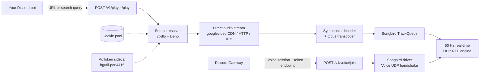

<div align="center">
<p align="center">
  <picture>
    <source media="(prefers-color-scheme: dark)" srcset="assets/light_1.svg">
    <source media="(prefers-color-scheme: light)" srcset="assets/dark_1.svg">
    
  </picture>
</p>

**Ultra-lightweight, bare-metal Discord audio engine written in Rust.**

A zero-GC, sub-millisecond, low-memory replacement for Java Lavalink.

[](LICENSE)
[](https://www.rust-lang.org/)
[](#-quick-start)
[](https://github.com/serenity-rs/songbird)
[](https://github.com/Shnimlz/axAudio/stargazers)
[](https://github.com/Shnimlz/axAudio/issues)

[**Quick Start**](#-quick-start) ·
[**API Reference**](#-rest-api-reference) ·
[**Configuration**](#%EF%B8%8F-configuration) ·
[**YouTube Anti-Bot**](#%EF%B8%8F-youtube-anti-bot--botguard) ·
[**Bot Example**](#-discord-bot-integration)

|  📦 Binary  |    🧠 RAM    | 🚀 Startup |    🎚️ Transport     |
| :---------: | :----------: | :--------: | :-----------------: |
| **~8.4 MB** | **~8–15 MB** | **< 5 ms** | **50 Hz RTP / UDP** |
</div>

<br>

## 📖 Table of Contents

- [Why axAudio?](#-why-axaudio)
- [Features](#-features)
- [Architecture](#-architecture)
- [Quick Start](#-quick-start)
- [Running on Bare Metal](#-running-on-bare-metal)
- [Configuration](#%EF%B8%8F-configuration)
- [REST API Reference](#-rest-api-reference)
- [YouTube Anti-Bot & BotGuard](#%EF%B8%8F-youtube-anti-bot--botguard)
- [Discord Bot Integration](#-discord-bot-integration)
- [Roadmap](#-roadmap)
- [Contributing](#-contributing)
- [Disclaimer](#%EF%B8%8F-disclaimer)
- [License](#-license)

## 🤔 Why axAudio?

Running Lavalink means running a JVM. On a small VPS that is most of your RAM gone before a single song plays. **axAudio** does the same job as a single Rust binary that starts instantly and sips memory, so a 1 vCPU free-tier box can serve voice comfortably.

|                                                  |    **axAudio**     |   **Lavalink**   |
| :----------------------------------------------- | :----------------: | :--------------: |
| Language                                         |        Rust        |       Java       |
| Memory footprint                                 |    **~8–15 MB**    |     1.5 GB+      |
| Startup                                          |     **< 5 ms**     |   JVM warm-up    |
| Artifact                                         | **~8.4 MB binary** |    JVM + JAR     |
| Garbage collector                                |      **None**      |       Yes        |
| Built-in YouTube anti-bot (PoToken, cookie pool) |         ✅         | Plugin-dependent |

## ✨ Features

- 🦀 **Pure Rust core**: Songbird 0.4 + Symphonia 0.5, no GC pauses.
- 🎵 **Wide format support**: MP3, FLAC, AAC, OGG Vorbis, WAV, plus direct HTTP / ICY streams.
- 📡 **Real-time transport**: direct 50 Hz UDP RTP Opus streaming with hardware-accelerated ChaCha20-Poly1305 and AES-GCM encryption.
- ⚙️ **Simple REST control plane**: Axum 0.8 on a multi-threaded Tokio runtime.
- 🛡️ **YouTube bypass built in**: Deno JS runtime, PoToken sidecar and a multi-account cookie pool with automatic retry.
- 🎧 **Studio-grade fidelity**: native 48 kHz Opus (format 251), `tanh` soft-clipping and headroom normalization.
- 🪶 **Tuned for tiny servers**: defaults to `TOKIO_WORKER_THREADS=2`, ideal for Oracle Cloud Free Tier, AWS t4g/t3a and Hetzner VPS.
- 🐳 **One-command deploy** with Docker Compose.

## 🧩 Architecture



## 🚀 Quick Start

The fastest and most reliable way to run `axAudio` is Docker Compose.

**1. Clone the repo**

```bash
git clone https://github.com/YOUR_USER/axAudio.git
cd axAudio
```

**2. Export your YouTube cookies**

1. Log into YouTube in a desktop browser (preferably with a secondary / throwaway Google account).
2. Export your cookies in Netscape format with an extension such as **Get cookies.txt LOCALLY** (Chrome / Firefox).
3. Save the file as `cookies.txt` in the project root.
4. On Linux / VPS, give `yt-dlp` write access so it can persist refreshed session tokens:

   ```bash
   chmod 666 cookies.txt
   ```

**3. Start the stack**

```bash
docker compose up -d
```

This launches both `axAudio` and the `bgutil-pot` PoToken sidecar.

**4. Check that it's alive**

```bash
curl http://localhost:2333/health
```

<details>
<summary><b>🐋 Run as standalone Docker containers (without Compose)</b></summary>

<br>

```bash
# 1. Start the PoToken provider sidecar
docker run -d \
  --name bgutil-pot \
  --restart unless-stopped \
  -p 4416:4416 \
  brainicism/bgutil-ytdlp-pot-provider:latest

# 2. Build axAudio
docker build -t axaudio .

# 3. Run axAudio mounting your cookies.txt
docker run -d \
  --name axaudio \
  --restart unless-stopped \
  -p 2333:2333 \
  -e PORT=2333 \
  -e BGUTIL_POT_URL=http://host.docker.internal:4416 \
  -v $(pwd)/cookies.txt:/app/cookies.txt \
  axaudio
```

</details>

## 💻 Running on Bare Metal

<details>
<summary><b>Prerequisites</b></summary>

<br>

| Requirement                              | Install                                                                                                                                     |
| :--------------------------------------- | :------------------------------------------------------------------------------------------------------------------------------------------ |
| **Rust & Cargo** 1.80+                   | `curl --proto '=https' --tlsv1.2 -sSf https://sh.rustup.rs \| sh`                                                                           |
| **Build tools & Opus** (Ubuntu / Debian) | `sudo apt install -y cmake pkg-config libopus-dev python3 python3-pip`                                                                      |
| **Build tools & Opus** (macOS)           | `brew install cmake opus python`                                                                                                            |
| **Build tools & Opus** (Windows)         | Install [CMake](https://cmake.org/download/) and [Python 3](https://www.python.org/), and make sure Opus is in your `PATH` (or use `vcpkg`) |
| **Deno 2+** (Linux / macOS)              | `curl -fsSL https://deno.land/install.sh \| sh`                                                                                             |
| **Deno 2+** (Windows)                    | `irm https://deno.land/install.ps1 \| iex`                                                                                                  |
| **Python packages**                      | `pip install -U yt-dlp bgutil-ytdlp-pot-provider`                                                                                           |

</details>

**1. Run the PoToken sidecar**

```bash
docker run -d --name bgutil-pot -p 4416:4416 brainicism/bgutil-ytdlp-pot-provider:latest
```

**2. Add your `cookies.txt`** (Netscape format) to the project root.

**3. Run axAudio**

```bash
# Debug mode (fast compilation)
cargo run

# Or build the stripped, LTO-optimized release binary
cargo build --release
./target/release/axAudio
```

## ⚙️ Configuration

Everything is configurable through environment variables or a `.env` file.

| Variable                  | Default                                | Description                                                           |
| :------------------------ | :------------------------------------- | :-------------------------------------------------------------------- |
| `PORT`                    | `2333`                                 | HTTP server listening port.                                           |
| `AUDIO_BITRATE`           | `128000`                               | Opus bitrate in bps (e.g. `128000`, `192000`, `256000`, `384000`).    |
| `RUST_LOG`                | `axAudio=info,tower_http=info`         | Tracing log level filter.                                             |
| `TOKIO_WORKER_THREADS`    | `2`                                    | Tokio worker threads (recommended: your vCPU count).                  |
| `BGUTIL_POT_URL`          | `http://bgutil-pot:4416`               | URL of the Proof-of-Origin token sidecar.                             |
| `YTDLP_COOKIES_DIR`       | `/app/cookies`, `./cookies`            | Directory with multiple `.txt` cookie files for round-robin rotation. |
| `YTDLP_COOKIES_POOL`      | _none_                                 | Comma-separated list of cookie file paths.                            |
| `YTDLP_COOKIES_PATH`      | `/app/cookies.txt`, `./cookies.txt`    | Single Netscape `cookies.txt` fallback.                               |
| `YTDLP_COOKIES`           | _none_                                 | Raw Netscape cookie content or path override.                         |
| `YTDLP_FORMAT`            | `ba[format_id=251]/ba[acodec=opus]...` | Prefers YouTube's native 48 kHz Opus stream (format 251).             |
| `YTDLP_DEFAULT_SEARCH`    | `ytsearch:`                            | Search provider prefix for text queries.                              |
| `YTDLP_REMOTE_COMPONENTS` | `ejs:github`                           | EJS remote solver source. Set to `none` to disable.                   |
| `YTDLP_EXTRACTOR_ARGS`    | _auto (bgutil)_                        | Custom `--extractor-args` flags for `yt-dlp`.                         |
| `YTDLP_EXTRA_ARGS`        | _none_                                 | Extra flags forwarded directly to `yt-dlp`.                           |

## 📡 REST API Reference

All endpoints accept and return JSON. Snowflake IDs (`guild_id`, `channel_id`, `user_id`) can be numbers or numeric strings.

| Method | Endpoint                | Description                                                   |
| :----: | :---------------------- | :------------------------------------------------------------ |
| `GET`  | `/health` · `/v1/stats` | Health check and runtime stats                                |
| `POST` | `/v1/voice/join`        | Connect to a voice channel                                    |
| `POST` | `/v1/voice/leave`       | Disconnect from a voice channel                               |
| `POST` | `/v1/player/play`       | Enqueue a URL or search query                                 |
| `POST` | `/v1/player/control`    | Pause, resume, skip, stop, volume                             |
| `POST` | `/v1/player/queue`      | Inspect current track and upcoming queue                      |
| `POST` | `/v1/tracks/resolve`    | Resolve metadata and stream URL without playing               |
|  `WS`  | `/v1/events`            | Real-time WebSocket player events (track start / end / error) |

<details>
<summary><b>Health check & stats</b></summary>

<br>

```http
GET /health
GET /v1/stats
```

```json
{
  "success": true,
  "data": {
    "status": "healthy",
    "version": "0.1.0",
    "uptime_seconds": 120,
    "active_players": 1
  },
  "message": null
}
```

</details>

<details>
<summary><b>Join a voice channel</b></summary>

<br>

When Discord dispatches `VOICE_STATE_UPDATE` and `VOICE_SERVER_UPDATE`, forward the session parameters to `axAudio`:

```http
POST /v1/voice/join
Content-Type: application/json

{
  "guild_id": "123456789012345678",
  "channel_id": "987654321098765432",
  "session_id": "session_id_from_discord",
  "token": "voice_token_from_discord",
  "endpoint": "us-east1234.discord.media",
  "user_id": "112233445566778899"
}
```

</details>

<details>
<summary><b>Play a track</b></summary>

<br>

Enqueues a direct audio URL, a YouTube URL, or a text search query.

```http
POST /v1/player/play
Content-Type: application/json

{
  "guild_id": "123456789012345678",
  "url": "https://www.youtube.com/watch?v=GitbDhOPBGs",
  "volume": 1.0,
  "extractor_args": null,
  "extra_args": null,
  "cookies": null
}
```

| Field            | Required | Description                                                                                       |
| :--------------- | :------: | :------------------------------------------------------------------------------------------------ |
| `guild_id`       |    ✅    | Target guild.                                                                                     |
| `url`            |    ✅    | Direct stream (`.mp3`, `.ogg`, ...), YouTube URL, or search query (e.g. `ytsearch:lofi hip hop`). |
| `volume`         |          | Float from `0.0` to `2.0` (default `1.0`).                                                        |
| `extractor_args` |          | Per-request override for `yt-dlp --extractor-args`.                                               |
| `extra_args`     |          | Per-request extra CLI flags for `yt-dlp`.                                                         |
| `cookies`        |          | Per-request Netscape cookies text or file path.                                                   |

</details>

<details>
<summary><b>Player control (pause, resume, skip, stop, volume)</b></summary>

<br>

```http
POST /v1/player/control
Content-Type: application/json

{
  "guild_id": "123456789012345678",
  "action": "skip"
}
```

| `action` | Effect                                            |
| :------- | :------------------------------------------------ |
| `pause`  | Pauses current playback.                          |
| `resume` | Resumes paused playback.                          |
| `skip`   | Skips to the next item in the queue.              |
| `stop`   | Stops playback and clears the queue.              |
| `volume` | Sets output volume with `value` (`0.0` to `2.0`). |

```json
{
  "guild_id": "123456789012345678",
  "action": "volume",
  "value": 0.5
}
```

</details>

<details>
<summary><b>Resolve track metadata without playing</b></summary>

<br>

```http
POST /v1/tracks/resolve
Content-Type: application/json

{
  "query": "https://www.youtube.com/watch?v=GitbDhOPBGs"
}
```

```json
{
  "success": true,
  "data": {
    "title": "Song Title",
    "source_url": "https://www.youtube.com/watch?v=GitbDhOPBGs",
    "stream_url": "https://rr3---sn-...googlevideo.com/videoplayback?...",
    "duration_secs": 214,
    "author": "Artist Name",
    "thumbnail": "https://i.ytimg.com/vi/GitbDhOPBGs/maxresdefault.jpg"
  },
  "message": null
}
```

</details>

<details>
<summary><b>Leave a voice channel</b></summary>

<br>

```http
POST /v1/voice/leave
Content-Type: application/json

{
  "guild_id": "123456789012345678"
}
```

</details>

## 🛡️ YouTube Anti-Bot & BotGuard

Datacenter and cloud IPs are routinely hit with _"Sign in to confirm you're not a bot"_. `axAudio` ships a layered bypass:

| Layer                         | What it does                                                                                                                                                      |
| :---------------------------- | :---------------------------------------------------------------------------------------------------------------------------------------------------------------- |
| **Deno JS engine**            | `yt-dlp` needs a JavaScript runtime to decode YouTube's dynamic `base.js` player signatures. `axAudio` bundles Deno v2 for this.                                  |
| **PoToken sidecar**           | Integrates with [`brainicism/bgutil-ytdlp-pot-provider`](https://github.com/Brainicism/bgutil-ytdlp-pot-provider) to generate valid BotGuard PoTokens on the fly. |
| **Multi-account cookie pool** | Round-robin rotation across `./cookies/*.txt` or `YTDLP_COOKIES_POOL`, with automatic retry on the next cookie if one hits a challenge or rate limit.             |

<details>
<summary><b>🍪 Cookie pool details</b></summary>

<br>

- **Round-robin rotation** spreads searches and streams across accounts, so no single account gets flagged for "abnormal traffic".
- **Automatic retry**: if an account gets a temporary challenge, the next cookie in the pool is used immediately.
- **Cookie lifespan**: root credentials (`SID`, `HSID`, `SSID`) last **1–2 years**. Rotating tokens (`__Secure-1PSIDTS`, `SIDCC`) change often; `yt-dlp` refreshes them in the file on every request when write permissions are enabled (`chmod 666`).
- **Stream URL timeout**: the ~6-hour expiry only applies to individual `googlevideo.com` playback URLs, not your login. `axAudio` resolves fresh URLs per request and keeps an in-memory cache for fast replays.

</details>

### 🎧 Studio-grade audio

- **Native 48 kHz Opus (format 251)**: prioritizes YouTube's ~160 kbps stereo Opus stream. No lossy AAC conversion, no 44.1k → 48k resampling ringing, and clean sub-bass (20–100 Hz).
- **Soft-clipping**: Songbird's `use_softclip` applies a `tanh` limiter to intersample peaks near 0 dBFS, which removes harsh digital clipping while keeping bass dynamics intact.
- **Headroom normalization**: a 0.95 (-0.5 dBFS) true-peak margin keeps loud masters from overloading the output stage.
- **Configurable bitrate**: up to 384 kbps via `AUDIO_BITRATE`.

## 🤖 Discord Bot Integration

A minimal example with TypeScript and Discord.js:

```typescript
import axios from "axios";

const AXAUDIO_URL = "http://127.0.0.1:2333";

// 1. Join a voice channel
async function joinVoice(guild, channel, botUser) {
  // Collect the Discord Gateway voice events:
  // - GatewayDispatchEvents.VoiceServerUpdate
  // - GatewayDispatchEvents.VoiceStateUpdate
  const voiceData = await waitForDiscordVoiceHandshake(guild.id);

  await axios.post(`${AXAUDIO_URL}/v1/voice/join`, {
    guild_id: guild.id,
    channel_id: channel.id,
    session_id: voiceData.sessionId,
    token: voiceData.token,
    endpoint: voiceData.endpoint,
    user_id: botUser.id,
  });
}

// 2. Play audio
async function playTrack(guildId: string, query: string) {
  const response = await axios.post(`${AXAUDIO_URL}/v1/player/play`, {
    guild_id: guildId,
    url: query,
    volume: 1.0,
  });
  return response.data;
}

// 3. Skip the current track
async function skipTrack(guildId: string) {
  await axios.post(`${AXAUDIO_URL}/v1/player/control`, {
    guild_id: guildId,
    action: "skip",
  });
}
```

---

## 🗺️ Roadmap

- [x] Songbird 0.4 voice engine with Symphonia decoding
- [x] REST control plane (join, leave, play, control, resolve)
- [x] yt-dlp + Deno + PoToken sidecar
- [x] Multi-account cookie pool with round-robin and auto-retry
- [x] Docker Compose deployment
- [x] Queue inspection endpoint (`/v1/player/queue`)
- [x] WebSocket player events (`/v1/events`: track start / end / error)
- [ ] Seek / position control

Have an idea? [Open an issue](https://github.com/YOUR_USER/axAudio/issues).

---

## 🤝 Contributing

Contributions, issues and feature requests are welcome.

1. Fork the repo
2. Create your branch: `git checkout -b feat/amazing-feature`
3. Commit your changes: `git commit -m "feat: add amazing feature"`
4. Push: `git push origin feat/amazing-feature`
5. Open a Pull Request

If `axAudio` saves you RAM (and money), consider leaving a ⭐. It helps a lot.

[](https://star-history.com/#YOUR_USER/axAudio&Date)

---

## ⚠️ Disclaimer

Using YouTube cookies and automated extraction may violate YouTube's Terms of Service, and accounts used for it can be restricted or suspended. Use a throwaway account and use this software at your own risk. `axAudio` is not affiliated with Discord, YouTube or Google.

---

## 📜 License

Released under the [MIT License](LICENSE).
